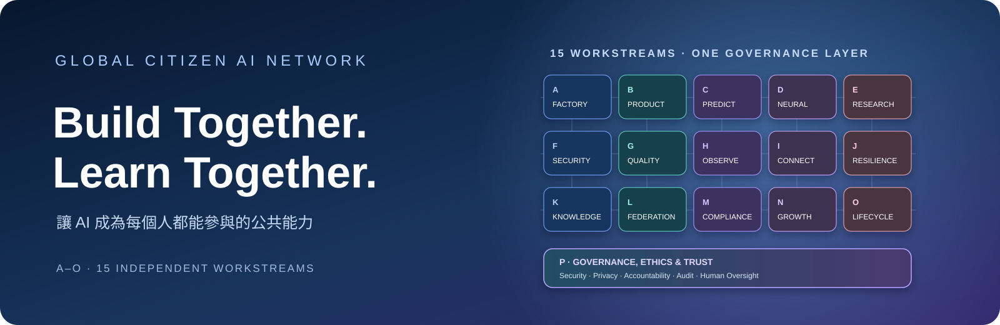
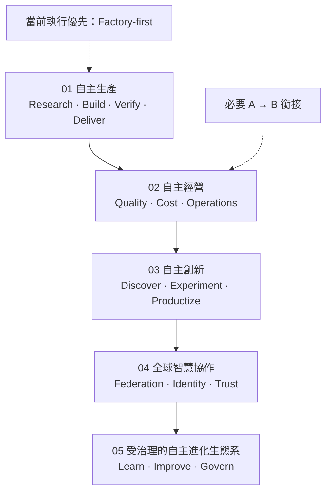
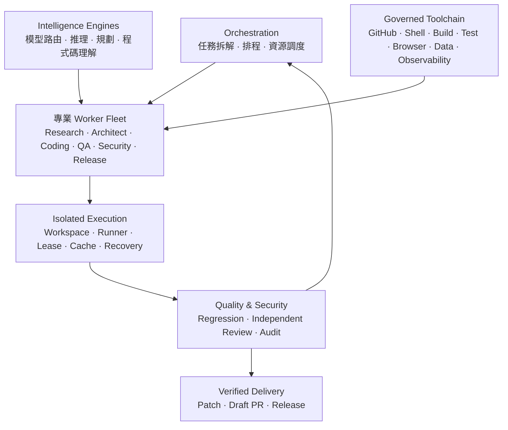
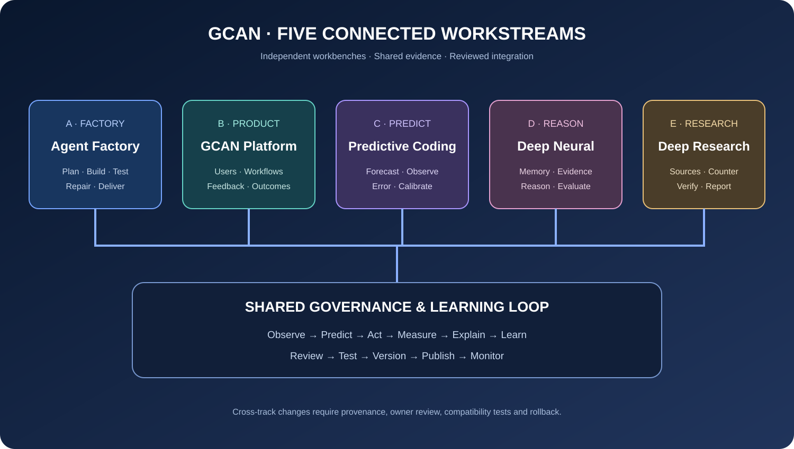
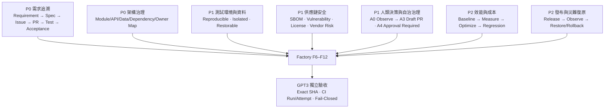

<div align="center">



### 把 AI 的力量，變成每個人都能參與的公共能力。

**一個結合 AI 服務、全球知識協作、透明貢獻帳本與自願式運算願景的長期平台。**

[產品網站](https://global-citizen-ai-network.vercel.app) · [GitHub 專案](https://github.com/X84657465/global-citizen-ai-network) · [Agent Factory V2（A 線 2.0.84）](https://github.com/X84657465/global-citizen-ai-network/pull/200) · [CI 工作流程](https://github.com/X84657465/global-citizen-ai-network/actions)


**Release:** `0.3.137` · A 線 Agent Factory V2 `2.0.84` · B 線 GCAN Product `0.1.20` · H 線 Observability `0.1.4` · P 線 Governance `0.1.3` · [版本紀錄](CHANGELOG.md) · [A–P 工程治理](docs/engineering-governance.md) · [A–P 線別架構與責任](docs/engineering-workstreams.md)

</div>

---


## ⚙️ GCAN 最高執行總綱｜Factory-first × 五 GPT 交付閉環

**目前工程順序：A Factory 優先 → 必要 A→B 銜接 → B 產品接棒。** 除非直接阻擋 A 穩定或 A→B，其他工作線不得平均分配資源。B 可持續完成產品需求、API／資料契約、UX 與測試規格準備，但不得提前啟動未就緒 Runtime 或正式資料操作。

| GPT | 正式責任 | 本輪硬性交付 |
|---|---|---|
| GPT1 | A–E / Factory Chief Engineer | 可執行 Factory 程式、回歸測試、exact-SHA CI 與 A→B 契約 |
| GPT2 | F–P Specialist Engineering | 只補阻擋 A/B 的安全、Release/QA、觀測及必要治理能力 |
| GPT3 | Independent Architecture / QA | 獨立審查、風險分級、exact-SHA 放行或退回 |
| GPT4 | B Product Lead | 產品需求、UX、API／資料契約與驗收規格 |
| GPT5 | Global Engineering Operations + Second Execution Seat | 任務派工、阻塞清理、跨線整合及受授權的非衝突開發 |

**零空轉：** 每項任務需有唯一 DRI、Developer、Reviewer、allowlist、DoD、依賴、測試、期限及 fallback。同一根因失敗兩次停止盲重試；阻塞超過一個工作週期必須拆解、改派、升級或暫緩。開發者不得自我批准。

**證據規則：** PENDING、0 Job、SKIPPED、CANCELLED、UNKNOWN、外部 rate limit 都不是 PASS。CI 必須綁定精確 SHA 與實際必要 jobs。GitHub Actions 與 Vercel deployment 狀態分開判定。角色規範不代表五個 GPT 已同時啟動；實際派工以 Issue／PR／Agent Runtime 紀錄為準。

- [完整 GCAN Execution Operating System](docs/GCAN_EXECUTION_OPERATING_SYSTEM.md)
- [Master Governance Charter](docs/GCAN_MASTER_GOVERNANCE_COORDINATION_CHARTER.md)
- [五 GPT 協作入口](PROJECT_COORDINATION.md)
- [神經智慧體協作模式](GCAN_NEURAL_INTELLIGENCE_AGENT_MODE.md)

---


## 🏛️ GCAN 公開入口｜願景、架構與進度一眼看懂

GitHub README 與 [GCAN 官方網站](https://global-citizen-ai-network.vercel.app) 是本專案兩個主要公開入口。README 面向開發者與貢獻者；網站首頁面向使用者與合作夥伴。兩處會以一致的事實來源、不同的閱讀路徑，持續提供圖文並茂的總覽。

### GCAN 五層進化路線



### 雙首頁各自提供什麼

| 公開入口 | 主要讀者 | 優先圖文內容 |
|---|---|---|
| GitHub README | 開發者、審查者、貢獻者 | 架構圖、A–P 責任地圖、Factory-first 路線、版本／CI 證據、貢獻指南 |
| [官方網站首頁](https://global-citizen-ai-network.vercel.app) | 使用者、合作夥伴、首次訪客 | GCAN 願景、核心能力、使用者旅程、進化路線、信任治理、產品入口 |

**展示原則：** 圖解必須搭配精簡文字、狀態標示與可核對證據；概念圖不冒充已上線功能，示範資料不冒充正式營運。重要路線或能力變更時，先更新正式文件，再同步兩個首頁；每個發布週期檢查內容、連結、圖片、行動版與可讀性。

完整規範：[GCAN Master Governance & Coordination Charter §16](docs/GCAN_MASTER_GOVERNANCE_COORDINATION_CHARTER.md)。

---


### Agent Factory 生產引擎：工人 × 引擎 × 工具 × 執行環境

Factory 必須具備完整生產能力，而不只是模型與任務派發。以下是目標架構示意；各能力依階段盤點、實作及驗收，不代表全部已上線。



| 生產要素 | 要解決的問題 |
|---|---|
| 專業 Worker | 讓不同任務由具備相應技能的執行者完成 |
| 智慧引擎 | 依任務品質、成本與延遲選擇可替換模型 |
| 工具鏈 | 讓 Worker 能真正讀寫、建置、測試與觀測 |
| 執行環境 | 隔離任務、支援安全併發、逾時與恢復 |
| 調度與 QA | 控制依賴、成本、風險，確保成果可驗證 |

**建設順序：** 先盤點現有能力與瓶頸，再補 Worker 契約、引擎／工具登記、安全執行與獨立 QA；不因架構圖而重複新增模型、Runner 或服務。

完整規範：[Master Charter §17](docs/GCAN_MASTER_GOVERNANCE_COORDINATION_CHARTER.md)、[Factory Charter §13](docs/AGENT_FACTORY_AUTONOMY_CHARTER.md)。

---
## 🧠 GCAN 神經智慧體模式｜最高工程協作原則

**GCAN 不只建置 AI 產品，也以可追蹤、可驗證、可治理的神經智慧體工作模式，持續建置自身的 AI 工程能力。**

所有工程協作依循同一個閉環：

**感知 → 記憶 → 認知 → 規劃 → 授權 → 執行 → 驗證 → 反思 → 知識更新**

### 六層自主工程能力

| 層級 | 核心責任 | 必須留下的證據 |
|---|---|---|
| 1. 感知 Perception | 讀取 Repository、Issues、PR、CI、版本、日誌與使用者需求 | 來源、時間、精確 SHA、未知事項 |
| 2. 記憶 Memory | 保存架構、決策、任務、缺陷、風險與驗收知識 | 版本化文件、來源、更新紀錄 |
| 3. 認知 Cognition | 根因分析、依賴推理、方案比較、風險與反例檢查 | 推理依據、假設、不確定性 |
| 4. 規劃 Planning | 拆解任務、排序依賴、指定 owner 與驗收條件 | 任務、優先級、範圍、停止條件 |
| 5. 執行 Execution | 在授權範圍內修改、測試、建立 PR 與交接 | Commit、PR、測試輸出 |
| 6. 驗證與反思 Verification / Reflection | 對精確 SHA 驗證、分析差異、修正並更新知識 | CI、Review、驗收狀態、回復方式 |

### 五個 GPT 的責任邊界

| 角色 | 正式責任 | 不可越界事項 |
|---|---|---|
| GPT1 | A–E；Agent Factory V2 與 Factory→B 主線協調 | 不覆蓋 GPT2 的 F–P 成果 |
| GPT2 | F–P 專業能力平行建設 | 不任意接管 A–E 核心與 Factory 私有狀態 |
| GPT3 | 跨 A–P 獨立架構審查、整合與 QA | 不取代功能 owner；獨立驗收不可由開發者自評取代 |
| GPT4 | B — GCAN Product 產品負責角色 | 負責產品方向、需求、產品契約與 B 主線交付；A→B 仍須經 GPT1／GPT3 閘門 |
| GPT5 | Global Intelligence & Operations | 全域最新情報、技術研究、來源查核、資安／版本預警、工程營運與知識庫支援；不接管 A–P owner |

神經智慧體模式是 GPT1–GPT5 共用的工程工作閉環；GPT5 是正式情報與營運支援角色，但不新增 A–P 工作線 owner。D｜Deep Neural 仍保有原本的記憶、推理、知識整合與評估責任，不因本模式而被接管。

### 最高開發優先順序

1. **Factory-first：** 優先維持 Agent Factory V2 核心穩定、任務閉環、隔離執行、有限重試、精確 SHA 驗證及可恢復交付。
2. **必要 A→B 銜接：** 只補足阻擋交接的介面、版本相容、安全與驗收卡點。
3. **F–P 必要支援：** 只優先處理直接阻擋 P0／P1 的安全、品質、可觀測性、文件及治理缺口。
4. **逐步擴張：** 非必要重構與新功能不得排擠工廠穩定性。

### 自主執行與安全界線

- 對安全、可回復且已授權的工作，可直接分析、修改、測試、驗收並留下紀錄，不必反覆要求使用者下達相同指令。
- 任何成果都必須區分「已記錄、已採納、已實作、已驗收」，不能以文件存在或模型宣稱取代證據。
- 不得跳過 CI、獨立 Review、Branch Protection 或精確 SHA 驗證。
- 生產部署、不可逆資料操作、權限／秘密／安全政策變更及財務支出，仍須遵守人工核准門檻。
- 聊天模型本身不等於具備背景常駐能力；持續監控與自主排程必須有實際事件來源、持久化儲存、排程器、最小權限、監控、審計及停止機制。

**成熟度分級：** L0 對話協助 → L1 證據感知 → L2 自主規劃 → L3 授權執行 → L4 持久閉環 → L5 受治理的持續運作。每一級都必須以實際程式、部署、測試及稽核證據驗收。

完整規範：[Agent Factory 自主開發最高核心章程](docs/AGENT_FACTORY_AUTONOMY_CHARTER.md) · [GCAN B 主線負責人章程](docs/GCAN_B_LINE_LEAD_CHARTER.md) · [GCAN Product North Star](docs/GCAN_PRODUCT_NORTH_STAR.md) · [GCAN 神經智慧體協作模式](GCAN_NEURAL_INTELLIGENCE_AGENT_MODE.md) · [GPT 協作與專案協調規範](PROJECT_COORDINATION.md) · [A–P 工程治理](docs/engineering-governance.md)。

---

## 🔎 歷史五線驗證快照｜2026-11-20（非目前主線狀態）

| 主線 | PR | 最新已查核 CI | 狀態 |
|---|---:|---|---|
| A｜Agent Factory V2 | [#134](https://github.com/X84657465/global-citizen-ai-network/pull/134) | [Run #44721263122](https://github.com/X84657465/global-citizen-ai-network/actions/runs/44721263122) | 前一 exact SHA 完整 CI 通過；本次新增的 A 線 synthetic Runner preflight 觸發仍待驗收 |
| B｜GCAN Product | [#137](https://github.com/X84657465/global-citizen-ai-network/pull/137) | [Run #44580554679](https://github.com/X84657465/global-citizen-ai-network/actions/runs/44580554679) | 該提交 CI 通過 |
| C｜Predictive Coding | [#139](https://github.com/X84657465/global-citizen-ai-network/pull/139) | [Run #44580087470](https://github.com/X84657465/global-citizen-ai-network/actions/runs/44580087470) | 該提交 CI 通過 |
| D｜Deep Neural | [#140](https://github.com/X84657465/global-citizen-ai-network/pull/140) | [Run #44580264020](https://github.com/X84657465/global-citizen-ai-network/actions/runs/44580264020) | 該提交 CI 通過 |
| E｜Deep Research | [#141](https://github.com/X84657465/global-citizen-ai-network/pull/141) | [Run #44580352440](https://github.com/X84657465/global-citizen-ai-network/actions/runs/44580352440) | 該提交 CI 通過 |

**注意：** 此表是 2026-11-20 的歷史快照，PR、SHA 與 CI 狀態不可視為目前主線狀態。任何驗收都必須重新核對當前 main、最新 PR HEAD 與 exact-SHA CI。示範資料不代表已接通正式資料來源或持久化服務。

### 五線入口

- A｜[Agent Factory V2 工廠控制台](https://github.com/X84657465/global-citizen-ai-network/tree/feat/agent-factory-v2)
- B｜[GCAN Product 產品線](https://github.com/X84657465/global-citizen-ai-network/tree/feat/gcan-product-homepage)
- C｜[Predictive Coding 預測編碼](https://github.com/X84657465/global-citizen-ai-network/tree/feat/github-project-showcase)
- D｜[Deep Neural 深度神經工作台](https://github.com/X84657465/global-citizen-ai-network/tree/feat/deep-neural-core)
- E｜[Deep Research 深度研究工作台](https://github.com/X84657465/global-citizen-ai-network/tree/feat/deep-research-workbench)

## 🧩 A–P 全線工程索引

以下列出 GCAN 全部十六條獨立工程線及其責任邊界。此表定義工作範圍，不代表功能已正式上線；實際成熟度須以 main 最新 PR、精確 SHA、完整 CI、Review 與驗收證據為準。

| 線別 | 工程線名稱 | 主要作用 | 責任成熟度 |
|---|---|---|---|
| A | **Agent Factory V2** | AI 自動開發工廠：需求拆解、任務派送、隔離執行、測試、候選 PR、CI 證據與復原。 | 依 mainline 證據追蹤 |
| B | **GCAN Product** | GCAN 主產品：公開網站、會員體驗、AI 工作台、全球貢獻流程與平台服務。 | 依 mainline 證據追蹤 |
| C | **Predictive Coding（預測編碼）** | 預測與觀測、預測誤差計算、信心校準、漂移分析及可驗證的模型更新訊號。 | 依 mainline 證據追蹤 |
| D | **Deep Neural（深度神經）** | 知識記憶、推理、知識整合、評估與跨線學習提案。 | 依 mainline 證據追蹤 |
| E | **Deep Research（深度研究）** | 多來源研究、來源品質與溯源、交叉查證、反證分析及引用式研究報告。 | 依 mainline 證據追蹤 |
| F | **Cyber Security & Defense（資安防禦）** | 跨線威脅模型、安全控制、弱點驗證、漏洞應變與事件準備。 | 依 mainline 證據追蹤 |
| G | **Release, QA & Integration（發布、品質與整合）** | 跨線整合順序、相容性矩陣、回歸測試、發布關卡、精確 SHA 證據與回滾準備。 | 規劃／分階段啟動 |
| H | **Observability, Telemetry & Cost/Quota Governance（可觀測性、遙測與成本配額）** | Queue／Runner 健康、任務耗時、失敗分類、成本來源、配額與安全暫停告警。 | 規劃／分階段啟動 |
| I | **Ecosystem, Connectors & Workflow Automation（生態串接與流程自動化）** | 外部 API、Webhook、通知、資料同步、冪等處理與防重播工作流。 | 規劃／分階段啟動 |
| J | **Self-Healing, Chaos & Continuity（自我修復、混沌與持續營運）** | 有限重試、熔斷、安全降級、檢查點、備份還原及受控故障演練。 | 規劃／分階段啟動 |
| K | **Knowledge Base, Docs & Governance Playbooks（知識庫、文件與治理手冊）** | 架構紀錄、線別責任、操作手冊、交接模板、決策紀錄與故障排查。 | 規劃／分階段啟動 |
| L | **Multi-Node, Federation & Edge/Cluster Coordination（多節點、聯邦與叢集協調）** | 未來自願加入節點的身分、能力排程、租約 fencing、健康檢查與跨節點協調。 | 規劃／分階段啟動 |
| M | **Compliance, Policy Audit & Risk Governance（法遵、政策稽核與風險治理）** | 可稽核事件、政策證據、風險登錄、限時例外及資料保留控制。 | 規劃／分階段啟動 |
| N | **Productization, Analytics & Growth/Ecosystem Ops（產品化、分析與成長營運）** | 隱私友善的產品指標、採用與品質分析、回饋循環、新手導引及生態營運。 | 規劃／分階段啟動 |
| O | **Lifecycle, Deprecation & Legacy Retirement（生命週期、棄用與舊系統退場）** | 棄用清單、遷移窗口、相容性契約、移除核准及舊系統維護成本降低。 | 規劃／分階段啟動 |
| P | **Governance, Ethics & Trust/Policy Evolution（治理、倫理、信任與政策演進）** | 自主權限分級、人類核准門檻、信任原則、政策演進及跨線優先級仲裁。 | 規劃／分階段啟動 |

**優先與依賴原則：** A（Agent Factory V2）為目前最高優先工廠主線；B（GCAN Product）在 A 的必要能力驗收後銜接。C–H 僅處理必要的能力依賴與整合卡點；I–P 保持獨立責任、版本與路線，依 G/H/K 等基礎能力及安全證據分階段啟動。L 多節點／分散式執行在容量證據、明確自願授權及獨立資安審查完成前維持延後。

完整責任邊界、非目標、跨線介面、階段交付物與退出條件見 [A–P 線別架構文件](docs/engineering-workstreams.md)。


## 🧭 快速導覽

| 了解 GCAN | 深入技術 |
|---|---|
| [專案願景](#-專案願景) · [平台核心](#-平台核心) · [專案現況](#-專案現況) | [Agent Factory V2](#-agent-factory-v2ai-自動開發工廠) · [技術架構](#️-技術架構) · [品質驗證](#-品質驗證) |
| [開發路線圖](#️-開發路線圖) · [參與與貢獻](#-contribution參與與貢獻) | [本機開發](#-local-development本機開發) · [文件導覽](#-文件導覽) · [安全原則](#️-安全隱私與公平原則) |

## 🌐 GCAN 是什麼？

**Global Citizen AI Network（GCAN，全球公民 AI 網路）**，目標是打造一個以人為本、重視透明與安全的 AI 協作生態系。

我們希望讓不同地區、不同專業、不同資源條件的人，都能使用 AI、貢獻知識、參與協作；也讓每一次 AI 使用、每一項任務成果與每一筆成本或貢獻紀錄，都能有清楚的規則與可追蹤的依據。

<div align="center">

| 🤖 全民 AI 服務 | 🌍 全球知識貢獻 | 🧾 透明成本與獎勵 | 🖥️ 自願式運算 |
|:---:|:---:|:---:|:---:|
| 研究、寫作、分析與知識工作 | 任務、提交、審核與複核 | 成本、貢獻與稽核紀錄 | 明確授權、隔離、可暫停 |
| **逐步建置中** | **逐步建置中** | **基礎流程建置中** | **長期研究方向** |

</div>

> **核心信念：AI 不應只是少數人的工具；知識貢獻應該被尊重，成本與規則應該透明，設備資源只能在使用者知情且自願的情況下參與。**

### 專案目前在哪個階段？

<blockquote>
<strong>早期開發／MVP 建置階段。</strong><br/>
核心應用、資料庫流程與 Agent Factory V2 正在持續開發及驗證。網站網址可供查看，但不代表所有功能已正式開放，也不代表已進入正式商業營運。
</blockquote>

- **目前開發主線：** `feat/agent-factory-v2`
- **Agent Factory V2：** [PR #134（Draft）](https://github.com/X84657465/global-citizen-ai-network/pull/134)
- **GCAN 產品線：** [PR #137（Draft）](https://github.com/X84657465/global-citizen-ai-network/pull/137)
- **GitHub 專案展示線：** [PR #139（Draft）](https://github.com/X84657465/global-citizen-ai-network/pull/139)
- **第三線預測編碼：** [架構文件](docs/predictive-coding-architecture.md)
- **第四線深度神經：** [PR #140（Draft）](https://github.com/X84657465/global-citizen-ai-network/pull/140) · [架構分支](https://github.com/X84657465/global-citizen-ai-network/tree/feat/deep-neural-core) · [架構文件](https://github.com/X84657465/global-citizen-ai-network/blob/feat/deep-neural-core/docs/deep-neural-architecture.md)
- **第五線深度研究：** [PR #141（Draft）](https://github.com/X84657465/global-citizen-ai-network/pull/141) · [工作台分支](https://github.com/X84657465/global-citizen-ai-network/tree/feat/deep-research-workbench)
- **五線版本制度：** [VERSION](VERSION) · [版本清單](versions/manifest.json) · [CHANGELOG](CHANGELOG.md)
- **最新 CI：** [查看 GitHub Actions](https://github.com/X84657465/global-citizen-ai-network/actions)
- **正式部署：** 尚未宣告完成；高風險發布與正式資料變更保留人工控制。

---


## ✨ 一句話認識本計畫

**Global Citizen AI Network（GCAN）是一個以人為本的 AI 協作平台。**  
我們希望讓一般使用者能以合理、透明的方式使用 AI，也讓研究、翻譯、資料整理、模型評測、內容查核與工具開發等知識貢獻，成為可驗證、可追蹤、可公平評價的工作。

長期而言，平台將逐步探索使用者自願參與的分散式運算網路，讓閒置 CPU／GPU 資源在明確授權、安全隔離及可退出的前提下，成為公共 AI 基礎設施的一部分。

> **我們不是單純再做一個聊天機器人，也不是以代幣或投資回報為核心的專案。**  
> 我們要建立的是一套結合 AI 服務、真實貢獻、透明帳務、社群治理與自願運算的長期協作系統。

## 🎯 專案願景

AI 的價值不應只集中在少數大型平台。GCAN 希望建立一個開放協作、責任清楚、成本可理解的生態系，讓不同地區、不同專業與不同資源條件的人，都有機會參與 AI 時代的創造。

### 我們想解決的問題

| 現況問題 | GCAN 的設計方向 |
|---|---|
| AI 工具分散，使用成本不易理解 | 建立整合式 AI 工作空間與可追蹤的使用成本 |
| 知識整理、翻譯、查核等工作缺少透明的協作流程 | 建立任務、提交、審核、申訴與貢獻紀錄 |
| AI 服務成本與實際資源消耗不透明 | 區分供應商費用、推估成本、人工審核與營運支出 |
| 社群貢獻難以驗證與公平評價 | 以明確驗收條件、審核紀錄及可稽核帳本管理 |
| 分散式運算容易產生隱私與設備安全疑慮 | 採自願加入、明確授權、隔離執行及可退出原則 |

## 🧭 平台核心

### 1. 🤖 AI Service Center｜全民 AI 服務中心

讓使用者在同一個工作空間完成日常知識工作：

- AI 對話、研究整理、寫作與內容分析。
- 文件與資料工作流程。
- 可持續保存的工作對話與專案脈絡。
- 透過伺服器端 AI Gateway 管理模型呼叫。
- 以使用者與全域預算限制控制 AI 成本。
- 供應商憑證未完成設定或預算條件不符時，採取 fail-closed 保護，不任意送出付費請求。

**目前狀態：** 工作空間與相關 API 已有程式實作；實際 AI 供應商服務仍受憑證、資料庫控制及預算設定限制，不代表正式 AI 服務已全面開放。

### 2. 🌍 Global Contribution Center｜全球知識貢獻中心

讓每一份可驗證的知識工作都有清楚的流程：

- 任務發布、任務條件與驗收標準。
- 研究、翻譯、資料整理、評測、事實查核及工具製作等任務類型。
- 成果提交與審核。
- 退件原因、申訴與複核。
- 個人貢獻紀錄及獎勵帳本。
- 任務獎勵與實際付款分離管理。

**重要原則：** 提交成果不等於自動取得獎勵；必須依任務規則完成驗證。現階段帳本中的待處理獎勵不等於可提領現金，尚未啟用自動付款。

### 3. 🧾 Transparent Cost & Reward Ledger｜透明成本與貢獻帳本

平台需要能回答：資源花在哪裡、貢獻如何被認定、獎勵如何產生。

- 分開記錄 AI 供應商回報費用與內部推估成本。
- 區分已分攤成本、帳單匯入及供應商用量資料。
- 保留貢獻事件、審核結果、待處理獎勵與稽核事件。
- 重要審核與帳本寫入採資料庫交易及冪等控制。
- 不以未實現收益承諾獎勵，也不保證投資報酬。

### 4. 🖥️ Distributed Compute Network｜自願式分散運算網路（長期方向）

未來將研究讓使用者選擇提供閒置 CPU／GPU 資源的方式：

- 使用者必須明確選擇加入，不得暗中使用設備資源。
- 清楚呈現運算工作、資源需求與使用狀態。
- 工作負載隔離、權限最小化與資源限制。
- 可暫停、退出及檢視運算紀錄。
- 在安全模型、威脅分析及獨立審查完成前，不啟用真實分散式運算任務。

**目前狀態：** 屬於長期架構方向，不代表目前已建立可供大眾加入的運算網路。

---

## 🏭 Agent Factory V2｜AI 自動開發工廠

GCAN 不只要提供 AI 服務，也正在建構一套能協助平台本身持續演進的自動化開發流程。

Agent Factory V2 的目標，是把需求整理、任務規劃、程式修改、隔離測試、候選 PR 與結果回報串成可追蹤的工程生命週期。

### 核心工作流程

```text
需求／Issue
    │
    ▼
任務選擇與優先級排序
    │
    ▼
版本化任務狀態與 Worker Lease
    │
    ▼
本機 AI 規劃（唯讀計畫）
    │
    ▼
候選程式碼產生與範圍驗證
    │
    ▼
隔離環境測試
    │
    ▼
候選分支與 Draft Pull Request
    │
    ▼
精確 SHA 綁定的 CI 驗證
    │
    ├── 通過 → 記錄驗證結果，等待人工審查
    │
    └── 失敗 → 分類、有限重試或隔離問題任務
```

### V2 已實作的關鍵能力

- **Durable Task State：** 以版本化狀態保存任務進度，避免只依賴短暫的 Runner 記憶。
- **Single Active Lease：** 同一任務以 Worker Lease 控制有效執行者，降低過期工作者覆寫新狀態的風險。
- **Failure Separation：** 區分任務本身失敗與系統基礎設施失敗，避免單一錯誤錯誤地觸發全域熔斷。
- **Bounded Retry & Quarantine：** 有限重試、退避及隔離機制，避免無限重跑。
- **Exact Candidate CI：** 將驗證結果綁定 PR 編號、候選 SHA、CI Run ID 與 Run Attempt，拒絕過期結果。
- **Deterministic Publisher：** 候選分支與 PR 發布具備可恢復性；遇到模糊 API 結果時先核對遠端狀態。
- **Patch Integrity：** 以雜湊與位元組數綁定測試過的 patch，發布前再次核對內容。
- **Concurrency Control：** 透過共用 Actions concurrency gate 與程序內寫入佇列，降低狀態競爭。
- **API Resilience：** 共用 GitHub API client，依 HTTP 方法與重試安全條件執行有限重試。
- **Isolated Candidate Execution：** 候選依賴安裝與測試使用受限容器；不向不受信任的候選程式碼傳遞 GitHub 寫入憑證，並限制網路、Linux capabilities 與檔案系統權限。

### 安全邊界

Agent Factory 的自動化不等於無限制自主部署：

1. AI 產生的程式碼必須先通過範圍驗證與隔離測試。
2. 候選 PR 必須接受 CI 驗證，且驗證結果必須對應精確 SHA。
3. 不自動核准、不自動合併、不自動關閉原始需求 Issue。
4. 正式環境部署與資料庫正式變更仍須由人類控制。
5. 任務狀態、重試、隔離與錯誤原因必須能追蹤。

### 目前驗證紀錄

- CI 結果必須以最新候選提交 SHA 對應的 GitHub Actions Run 為準；舊提交曾經通過，不代表目前分支已通過。
- Agent Factory V2 的 Patch 分批輸出、決策閘門及測試正在持續修正與重新驗證。
- GCAN 產品線持續驗證單元測試、資料庫整合測試及手機版介面。
- 尚未宣稱完成 24 小時無人值守運行、Runner 重啟復原或完整端到端自動開發生命週期驗收。
- [GitHub Actions 全部工作流程](https://github.com/X84657465/global-citizen-ai-network/actions) 可查詢最新狀態。

---

## 🏗️ 技術架構

GCAN 採用分層設計，將使用者介面、領域邏輯、資料庫權限、AI 呼叫及自動化工作流程分開管理。

| 層級 | 技術／元件 | 職責 |
|---|---|---|
| Web 前端 | Next.js、React、TypeScript | 網站介面、頁面路由與互動 |
| 應用服務 | Next.js API Routes、共享 domain logic | 驗證請求、執行業務規則 |
| 資料庫 | PostgreSQL、Supabase | 帳戶資料、任務、審核、帳本及持久化狀態 |
| 資料安全 | Supabase RLS、資料庫 RPC | 使用者資料隔離、權限檢查及原子化操作 |
| AI 整合 | Server-side AI Gateway、Ollama 開發測試 | 模型呼叫、預算限制及本機推論測試 |
| 工程自動化 | GitHub Actions、Windows Self-hosted Runner、Docker | CI、隔離測試及 Agent Factory 任務流程 |
| 部署目標 | Vercel Preview／Production | 網站建置與部署；正式上線仍需完成發布條件 |

### 系統設計原則

- **Security by Design：** 權限、資料隔離及憑證管理納入架構，而不是上線後才補救。
- **Fail Closed：** 權限或預算條件無法確認時，拒絕執行敏感操作。
- **Idempotency：** 對重要寫入與重試建立冪等條件，避免重複入帳或重複處理。
- **Auditability：** 重要狀態變化保留可追蹤的事件與驗證證據。
- **Cost Awareness：** AI 用量與營運成本必須可計量、可限制。
- **Human Accountability：** 自動化負責提高效率，正式發布與高風險決策仍保留人工責任。

## 🛡️ 安全、隱私與公平原則

- 不得未經同意使用使用者設備的 CPU、GPU、頻寬或儲存空間。
- 不把使用者 API Key 或 GitHub 寫入憑證交給不受信任的候選程式碼。
- 不允許一般使用者讀取其他使用者的私人工作資料。
- 重要審核操作須在伺服器與資料庫層再次驗證權限。
- 不以 AI 自我評分作為唯一的貢獻驗收依據。
- 不保證收益、不要求投資、不以拉人頭或推薦層級作為獎勵核心。
- 志願貢獻必須明確揭露性質、授權條款與獎勵條件，不得以志願者永久取代應付薪酬的工作。
- 使用者資料的檢視、匯出與刪除，依產品功能及適用法令逐步實作。

## 🚦 專案現況

**目前定位：早期開發／MVP 建置階段，尚非正式商業營運服務。**

| 項目 | 現況 |
|---|---|
| Next.js 應用與主要頁面 | 已有程式實作 |
| 登入與帳戶介面 | 已有實作；正式公開註冊仍受設定限制 |
| AI 工作空間與伺服器端 API | 已有實作；供應商正式服務需完成設定 |
| 貢獻任務、提交與審核流程 | 已有資料庫與 API 實作 |
| 申訴與貢獻獎勵帳本 | 已有資料庫流程與介面實作 |
| AI 成本透明度管理 | 已有管理介面與資料分類 |
| Agent Factory V2 | 狀態機、任務執行、候選 PR 與 CI 整合持續開發；端到端驗收尚未完成 |
| Windows Runner／Docker／Ollama | 曾有工具鏈與有界推論通過紀錄；最新任務仍需重新驗證 |
| 24 小時無人值守實測 | 尚待真實長時間驗收 |
| Runner 重啟與中斷復原演練 | 尚待完成 |
| 分散式運算網路 | 長期規劃，尚未對外開放 |
| 自動獎勵付款 | 尚未啟用 |
| 正式公開上線 | 尚未宣告 |

> **透明聲明：** GitHub Actions 通過、程式碼存在或頁面可建置，不等於所有外部服務已完成設定，也不等於正式環境已上線。

## 🗺️ 開發路線圖

### Phase 1 — Foundation｜基礎平台
- [x] Next.js 應用骨架與核心路由
- [x] PostgreSQL／Supabase 資料結構與 RLS 基礎
- [x] AI 工作空間與伺服器端呼叫架構
- [x] 貢獻任務、提交、審核與申訴資料流程
- [x] 成本與貢獻帳本基礎
- [ ] 完成正式環境設定與發布驗收

### Phase 2 — Agent Factory V2｜自動開發工廠
- [x] 版本化任務狀態與 Worker Lease
- [x] 有限重試、退避、隔離與事件冪等
- [x] 候選 PR 精確 SHA 綁定與 CI 回報
- [x] Patch 雜湊完整性與發布復原邏輯
- [x] Windows Runner、Docker、Ollama 基礎檢查（歷史 CI 紀錄）
- [ ] Patch 產生與隔離測試端到端通過
- [ ] 真實長時間無人值守運行
- [ ] Runner 重啟／中斷復原演練
- [ ] 完整端到端任務生命週期驗收
- [ ] 更細緻的 GitHub Token 權限拆分與驗證

### Phase 3 — Public Beta｜公開測試
- [ ] 完成正式 AI 供應商與成本控管設定
- [ ] 完成使用者註冊、資料權限及隱私流程驗收
- [ ] 建立清楚的貢獻者規範與審核標準
- [ ] 小規模邀請測試與使用者回饋
- [ ] 監控、備份、復原及事故處理演練

### Phase 4 — Global Network｜全球協作網路
- [ ] 多語系與跨區域協作
- [ ] 更完整的任務市場與貢獻者聲譽機制
- [ ] 社群治理與透明財務報告
- [ ] 分散式運算威脅模型與獨立安全審查
- [ ] 在完成安全驗收後，才評估自願式運算節點試驗

## 📁 Repository Structure｜專案目錄

```text
.
├── app/                  # Next.js 頁面、路由與 API
├── lib/                  # 共用邏輯、領域服務與型別
├── components/           # 可重用 UI 元件
├── supabase/
│   └── migrations/       # PostgreSQL schema 與 RLS migrations
├── docs/                 # 產品、架構、安全與操作文件
├── tests/                # 單元、整合與政策回歸測試
└── .github/
    └── workflows/        # CI、Runner 與 Agent Factory 自動化
```

## 🚀 Local Development｜本機開發

### 環境需求

- Node.js 22.13 或更新版本
- npm
- Git
- 若要執行完整資料庫整合測試，需依測試文件準備 Docker 與 Supabase CLI

### 啟動專案

```bash
git clone https://github.com/X84657465/global-citizen-ai-network.git
cd global-citizen-ai-network
npm ci
cp .env.example .env.local
npm run dev
```

開啟瀏覽器前往：

```text
http://localhost:3000
```

請依照 `.env.example` 與相關文件設定環境變數。不要將真實 API Key、資料庫密碼或服務角色金鑰提交到 Git。

## 🧪 品質驗證

專案使用自動化檢查保護主要開發流程，依目前 CI 設定涵蓋：

- Unit Tests
- TypeScript Type Check
- ESLint
- Production Build
- Dependency Security Audit
- Migration Filename／Schema Safety Guards
- Supabase Migrations
- PostgreSQL Tests
- Row Level Security Tests
- Windows Self-hosted Runner Toolchain Checks
- Docker／Ollama Availability 與有界結構化推論

最新 CI 請以各主線上方的 exact-head 紀錄為準；A 線修復提交尚待重新執行完整 CI。

## 📚 文件導覽

| 文件 | 說明 |
|---|---|
| [產品範圍與分階段路線圖](docs/product-scope.md) | 產品目標、範圍與階段規劃 |
| [系統架構](docs/architecture.md) | 系統元件與架構設計 |
| [安全與隱私基線](docs/security-baseline.md) | 權限、資料與安全原則 |
| [資料模型與透明成本帳本](docs/data-model.md) | 核心資料結構與成本記錄 |
| [資料庫安全與上線前檢查](docs/database-safety.md) | 資料庫安全與驗收要求 |
| [資料庫設定](docs/database.md) | 資料庫相關說明 |
| [後端環境建置清單](docs/backend-setup.md) | 後端服務準備 |
| [API 文件](docs/api.md) | 應用 API 說明 |
| [AI 預算超額保護](docs/ai-budget-overrun-hard-stop.md) | AI 預算硬性停止機制 |
| [AI Agent Scheduler](docs/ai-agent-scheduler.md) | 自動開發工廠、Runner 與故障處理 |
| [AI Agent Scheduler](docs/ai-agent-scheduler.md) | 任務排程與執行機制 |
| [Claude 獨立審查簡報](docs/claude-review-brief.md) | 架構與安全審查清單 |


## 🎬 圖片與影片介紹｜Visual & Video Tour

### GCAN 五線總覽

<p align="center">
  
</p>

五條開發線各自擁有獨立工作台，透過來源追蹤、版本管理、測試與接收線審核互相協作。

### 影片導覽

**GCAN 平台介紹影片：製作規劃中。** 分鏡與旁白稿已列入專案文件；正式影片必須以真實工作台操作畫面錄製，不會使用虛構影片連結或把示範畫面冒充正式功能。

- [影片分鏡與旁白稿](docs/media/gcan-introduction-storyboard.md)
- [即時 CI 與開發紀錄](https://github.com/X84657465/global-citizen-ai-network/actions)

### 五線工作台與進度

> D、E 兩線以五線整合分支作為暫時整合基底；CI 已納入此基底分支的 PR 觸發條件，待整合分支合併 main 後再重新核對並調整 base。

| 線別 | 工作台 | 最新已知狀態 | 入口 |
|---|---|---|---|
| A｜Agent Factory V2 | 工廠控制台 | 已修正 DB-backed RLS 測試分流與失敗分類；新 exact-head CI 待驗證 | [PR #134](https://github.com/X84657465/global-citizen-ai-network/pull/134) |
| B｜GCAN Product | 全球產品平台 | CI 通過；待獨立驗收 | [PR #137](https://github.com/X84657465/global-citizen-ai-network/pull/137) |
| C｜Predictive Coding | 預測分析工作台 | CSS 修復候選；待 exact-head CI | [PR #139](https://github.com/X84657465/global-citizen-ai-network/pull/139) |
| D｜Deep Neural | 深度神經工作台 | 互動功能候選；待 exact-head CI | [PR #140](https://github.com/X84657465/global-citizen-ai-network/pull/140) |
| E｜Deep Research | 深度研究工作台 | 介面候選；待 CI 確認 | [PR #141](https://github.com/X84657465/global-citizen-ai-network/pull/141) |

> CI 通過不等於正式上線；示範資料、未連接的外部服務與開發中功能都必須清楚標示。

## 🧠 五線協作與持續學習

本專案採五線並行：A Agent Factory V2、B Global Citizen AI Network、C 預測編碼（Predictive Coding）、D 深度神經（Deep Neural）、E 深度研究（Deep Research）。各線獨立開發與驗收，透過經審核、具版本及來源證據的知識成果互相支援。深度神經負責整理可重用記憶、推理策略與評估方法；不直接取得其他線的寫入權限，也不以模型信心取代測試。

所有重大及小幅改進都必須更新純數字版本 `MAJOR.MINOR.PATCH`，並記錄變更、受影響線別、測試結果、精確 commit SHA 與回復方式。細節見 [五線工程治理規範](docs/engineering-governance.md)。

## 🔄 五線互輔互成｜Predict → Learn → Build → Validate

五線不是五個互不相干的專案，而是彼此提供輸入、回饋與驗證的協作系統：

| 線別 | 核心責任 | 支援其他線的方式 |
|---|---|---|
| A｜Agent Factory V2 | 自動化工程執行、測試、修復與交付 | 提供可重現的執行能力、CI 證據、故障分類與修復手冊 |
| B｜Global Citizen AI Network | 真實產品、使用者流程與全球協作場景 | 提供需求、使用回饋、營運限制與真實成效資料 |
| C｜預測編碼（Predictive Coding） | 預測、觀測、預測誤差、校準與模型更新 | 提供可量測的預測誤差、漂移訊號與改進依據 |
| D｜深度神經（Deep Neural） | 記憶、推理、知識整合與評估 | 將跨線證據整理為可追溯知識、推理策略及評估建議 |
| E｜深度研究（Deep Research） | 多來源研究、來源查核、反證與引用報告 | 提供可追溯的研究證據、方法、來源可信度與可執行建議 |

共同閉環：**觀測 → 預測 → 行動 → 結果量測 → 預測誤差分析 → 記憶與推理 → 修正方案 → 測試 → 回饋五線**。任何跨線改進都必須經版本管理、來源追蹤、接收線審核與相容性測試；預測或 AI 建議不得直接改寫正式環境。

### 第三線架構

[預測編碼架構文件](docs/predictive-coding-architecture.md)

## 🤝 Contribution｜參與與貢獻

我們歡迎具備不同專業的人參與未來建置，例如：

- AI 應用、前端與後端工程。
- PostgreSQL、資料安全與系統架構。
- 翻譯、研究、資料整理與事實查核。
- UI／UX、可用性與無障礙設計。
- 測試、自動化、文件與社群治理。

任何任務在開始前，都應清楚說明工作範圍、驗收條件、成果授權、是否有報酬，以及是否符合獎勵資格。請勿假設所有貢獻任務都會獲得報酬。

## 📜 License｜授權

目前尚未選定開源授權。正式加入 LICENSE 文件前，專案內容預設保留所有權利；未經授權請勿將其視為可自由再利用的開源程式碼。

---

<p align="center">
  <strong>Build Together. Learn Together. Make AI Useful for Everyone.</strong>
  <br />
  <sub>Global Citizen AI Network — A long-term project for shared intelligence and transparent collaboration.</sub>
</p>


## 🧭 Factory 最新七項橫向治理能力｜完整執行規格

以下七項能力已正式納入既有 F6–F12 的強制 Definition of Done，並與前述六項橫向能力（全域專案理解、任務拆解與調度、多層獨立驗證、有界除錯修復、自我評估與受控進化、安全治理與資源控制）共同執行。**不另建 F13–F19、不增加重複 GPT 席位或重複基礎設施。**先盤點現有實作，依 REUSE → EXTEND／REPAIR → 有 ADR 證據才 REPLACE。



| 優先級／能力 | 必須交付的內容 | 驗收條件 |
|---|---|---|
| **P0 需求追溯與交付完整性** | 每筆需求有 ID、來源、owner、優先級、依賴、驗收條件；建立需求→規格→Issue→PR/Commit→測試/CI→Review→接收線驗收雙向鏈；需求變更執行模組、API、schema、文件、測試、部署及跨線影響分析 | 可抽樣從需求追到實作、測試與驗收，也可由程式／測試反查需求；無測試或接收證據不得 ACCEPTED |
| **P0 架構治理與技術債** | 模組、服務、API、資料、事件、外部依賴、部署與 owner 地圖；偵測循環依賴、重複實作、孤兒模組、過期介面、耦合與高風險技術債；每項技術債有嚴重度、成本、owner、期限與處置 | 架構地圖符合當前 repo；高風險債務有決策與 owner；重構有相容性、行為前後比較、回歸與回滾證據 |
| **P1 測試環境與資料可靠性** | dev/test/preview/prod 隔離；runtime、依賴、schema、設定版本化；合成／去識別測試資料可初始化、隔離、清理、重建；失敗重播、故障注入、備份還原演練 | 他人可重建環境並重現結果；測試不污染正式資料；環境故障與產品缺陷可區分 |
| **P1 供應鏈與第三方依賴安全** | 追蹤套件／傳遞依賴來源、版本、授權、漏洞、維護狀態；條件允許產生 SBOM，掃描綁定候選 SHA；第三方 API、模型、CI Action、容器與部署服務記錄權限、資料流、成本、健康、替代與降級策略 | 高風險依賴阻擋或隔離發布；例外有風險接受者、期限、補償控制及稽核記錄 |
| **P1 人類決策與自主權治理** | A0 觀察建議；A1 讀取規劃；A2 隔離修改測試；A3 建立候選 PR；A4 合併、部署、付費、權限／Secrets、正式資料與不可逆操作必須明確核准 | 不得自行升級自治等級；未知、證據衝突或決策 owner 不明標 UNKNOWN／BLOCKED，列出選項與待決者 |
| **P2 效能、資源與成本** | API、DB、前端、Worker、模型 token、快取、重試與閒置資源基準；最佳化附同條件量測、收益、品質風險、回歸與回滾 | 改善可重現且無品質／安全退化；未核准不得開付費 API、採購模型或擴增 Runner |
| **P2 發布、災難復原與營運韌性** | 版本與變更摘要、相容性、遷移、部署前檢查、發布後健康監控、事故處置、回滾；備份與 RPO／RTO 及實際還原演練 | 候選版本有發布／回滾計畫；復原經實際演練；正式部署、DNS／權限切換及不可逆操作須明確授權 |

### 七項能力映射到 F6–F12

- **F6 Developer Engine：** 專案理解、需求追溯、架構地圖、變更影響分析、任務拆解與隔離單任務修改。
- **F7 Debug & Repair：** 可重現環境、測試資料治理、根因分析、有界修復、依賴風險與回歸。
- **F8 Orchestrator：** DAG、唯一 DRI、Worker 路由、環境／成本配額、鎖定、取消、有限重試與安全並行。
- **F9 Independent QA：** 需求覆蓋、多層測試、供應鏈掃描、精確 SHA、獨立審查及 Fail-Closed。
- **F10 Project Intelligence：** 版本化需求、ADR、架構、技術債、SBOM、環境、決策與證據記憶，具來源、可信度、過期與刪除治理。
- **F11 Self-Improvement & Recovery：** 效能／成本基準、受控改善 PR、發布健康、復原演練、獨立審查及回滾。
- **F12 Production-Grade Factory：** 需求到交付追溯、架構健康、供應鏈安全、容量成本、發布／災難復原與自治治理完整驗收。

### GPT1–GPT5 明確協作命令

- **GPT1／A–E：** Factory 建設與整合主責；盤點現有能力、拆解任務、安排唯一 DRI、建置與測試、產出精確 SHA 和候選 PR。不得自我核准。
- **GPT2／F–P：** 提供各領域規格、邊界案例、資料／安全限制、測試樣本及領域驗收；優先使用 Factory 已驗收能力，不複製通用功能。
- **GPT3：** 獨立架構、整合、安全與 QA；檢查精確 SHA、CI Run／Attempt、需求追溯、回歸及回滾。證據缺漏、SHA 不符、CI 未完成或 reviewer 不獨立即 Fail-Closed。
- **GPT4／B：** 決定產品方向、需求、UX、產品契約與產品驗收；遵守版本化 A→B 契約，不直接存取 Factory 私有 Runner／Lease／Sandbox／Secrets。
- **GPT5：** 提供可追溯技術研究、漏洞／供應鏈情報、基準、風險及替代方案；程式變更須有明確 Issue、範圍及 DRI 指派，不取代模組 owner 或 GPT3。
- **專案負責人：** 保留預算、正式發布、合併政策、權限／Secrets、不可逆資料操作與對外承諾的核准權。

### 強制執行順序與證據規則

1. 先盤點 main、PR、CI、Issues、Factory 程式、權限、成本及能力證據；REUSE 優先，禁止無證據重寫。
2. P0 先建立需求追溯與架構／技術債基線。
3. P1 建立測試環境／資料可靠性、供應鏈掃描及自治等級控制，作為增加自動寫入和並行的前置條件。
4. P2 有量測基準後才優化成本效能；有明確授權及實際還原證據後才進行發布／DR。
5. 優先打通真實單任務 Issue→Plan→Worker→Isolated Edit→Build/Test→Draft PR→GPT3 Independent Review，再擴大並行。
6. 每項能力狀態 PLANNED → IMPLEMENTED → TESTED → VERIFIED → ACCEPTED，並綁定 owner、版本、精確 SHA、測試命令／結果、CI Run／Attempt、獨立 reviewer、限制、風險與回滾。缺證據標 NOT RUN／UNKNOWN；受阻標 BLOCKED。

**共同原則：Factory-first、證據優先、保留已驗證成果、專業線提供領域能力、GPT3 獨立驗收。文件、概念圖、模擬測試或不同 SHA 的 CI 不代表 runtime 已完成。任何 GPT 均不得自我核准、刪測試、無限重試、擴權、暴露 Secrets、未核准付費、合併、部署或操作不可逆資料。**


---

## 🌐 Factory F13–F19｜第二階段自主智慧與全球協作路線圖

## F13–F19 第二階段自主智慧生產與全球協作路線圖

F13–F19 是 F12 生產級 Factory 完成獨立驗收後的擴展階段。F0–F12 是安全、可重現、可驗收的自主工程生產基礎；F13–F19 在此基礎上擴展研究情報、產品組裝、跨智能體協作、營運智慧、模型生命週期、能力生態系與全球智慧網路。不得把本路線圖視為現況已部署，也不得跳過前置階段。各階段仍遵守 Factory-first、A→B 版本化契約、單一 DRI、最小權限、GPT3 獨立審查及人類核准邊界。

### F13 — Research & Intelligence Engine｜研究與情報引擎
**目的與範圍：** 將可信外部資料、研究文件、技術規格、專案內部知識與即時變動訊息轉化為可追溯、可更新、可比較的結構化情報。涵蓋來源連接器、擷取與解析、去重、語意索引、實體／主張抽取、來源可信度、時間有效性、版本差異、衝突偵測、證據鏈及研究報告生成。每項重要主張須保留來源、擷取時間、版本／快照、引用位置、信心與限制；模型生成不得偽裝成來源事實。
**執行與安全：** 先建立來源 allowlist、資料分類、授權／著作權檢查、個資與秘密遮罩、保留期限及刪除傳播。外部內容一律視為不可信資料，不得當成系統指令。來源不可用或內容過期時標記 STALE／UNKNOWN，不得靜默沿用。
**DoD：** 至少完成一條端到端研究任務：來源登錄→擷取→解析→去重→索引→主張與引用→交叉核對→研究輸出→來源失效／更新測試；獨立人員可從報告反查原始證據並重建結果。量測來源覆蓋率、引用完整率、過期率、衝突檢出率、錯誤主張率與處理成本。GPT3 對來源可信度、資料安全、提示注入防護及可重現性獨立驗收。
**前置／停止：** F12 ACCEPTED；F10 專案記憶及 F9 獨立驗證可用。無授權來源、無法保留證據鏈、資料分類不明或發現提示注入未隔離時，該來源／任務 BLOCKED。

### F14 — Product & Solution Assembly Engine｜產品與解決方案組裝引擎
**目的與範圍：** 將已核准需求、F13 情報、設計系統、API／資料契約及已驗證 Factory 能力組裝成可交付產品或解決方案。提供需求拆解、方案比較、架構／UX 藍圖、可重用模組與模板選擇、前後端及資料整合、遷移計畫、文件、測試矩陣與交付包。不得複製已存在的核心服務；優先 REUSE、EXTEND、REPAIR。
**執行與安全：** 產品 owner（B／GPT4）決定產品目標、需求優先級、UX 與產品接受條件；Factory 只依核准規格產生候選變更。對外部服務、付費 API、正式資料、正式部署、法規或高風險功能，先提出成本／風險／替代方案並等待授權。
**DoD：** 由一份核准需求產生可追溯的架構決策、UX 流程、模組清單、API／資料契約、Issue DAG、實作 PR、測試與發布候選包；需求到程式／測試雙向追溯完整，整合測試及回歸通過，產品 owner 與 GPT3 分別完成產品及技術驗收。以交付週期、需求覆蓋率、重用率、缺陷逃逸率及變更回滾率量測。
**前置／停止：** F12 ACCEPTED 且 F13 能提供可追溯情報；需求、資料權利、產品 owner 或接受條件缺失時不得自行補猜，標記 BLOCKED。

### F15 — Federated Multi-Agent Collaboration Engine｜聯邦多智能體協作引擎
**目的與範圍：** 讓不同 GPT、Agent、專案或受信任節點能以標準化任務契約協作。包括 Agent 身分與註冊、能力宣告、版本化協定、任務委派、回覆／事件格式、來源與責任追蹤、信任評估、跨節點工作流、超時／重試／取消、衝突處理及撤銷機制。協作以共享 Issue、PR、Review、CI、handoff 或經核准 API 為準，不假設模型之間具有私訊或隱性共享記憶。
**執行與安全：** 採零信任節點模型；每個節點獨立驗證身分、任務範圍、資料分類及工具權限。採短期憑證、簽章事件、重放防護、租約／fencing、速率與成本配額、資料最小化及可撤銷委派。外部 Agent 的輸出必須視為未驗證輸入，不能直接取得上游權限。
**DoD：** 先以兩個隔離測試節點完成可重現的委派、狀態追蹤、結果驗證、逾時取消、節點失聯、重放／偽造請求拒絕、權限撤銷與稽核；每個工作均可追溯委派者、執行者、資料範圍、工具、成本與產物 SHA。GPT3 獨立驗收身分、隔離、協定相容性與故障模式。
**前置／停止：** F12 ACCEPTED；F9 QA、F10 記憶治理及 F17 人類決策治理的基礎政策已建立。節點身分、授權或稽核不完整即拒絕委派；不得將聯邦協作等同於信任所有節點。

### F16 — Operations & Business Intelligence Engine｜營運與商業智慧引擎
**目的與範圍：** 把產品、Factory 與經授權業務流程的事件資料轉化為營運可觀測性、KPI、異常偵測、趨勢分析、容量／成本預測、流程瓶頸分析及決策建議。支援事件字典、資料品質檢查、指標語意層、儀表板、告警、工作流建議及可審核的行動草案。不得把相關性描述為因果，也不得以未經驗證的模型評分作為唯一決策依據。
**執行與安全：** 僅讀取明確授權的資料來源；遵守用途限制、最小化、去識別化、租戶隔離、保存期限與存取稽核。預設只讀與建議模式；對外通知、付款、人事、客戶資料修改、商業承諾等行動必須由有權人員核准。
**DoD：** 至少建立一個經資料 owner 核准的端到端指標流程：資料字典→品質／完整性檢查→指標計算→基準與異常→來源追溯→儀表板／報告→告警演練；指標可重算，資料延遲與缺失可見，錯誤輸入不會靜默產生錯誤決策。以資料新鮮度、完整率、指標重算一致性、告警精確率／召回率及建議採納後成效量測。
**前置／停止：** F12 ACCEPTED、F13 情報來源治理及 F17 決策權限政策可用。沒有資料 owner、合法用途或指標定義時不得接入；未經授權不得執行寫入或外部行動。

### F17 — Model Lifecycle & Continuous Evaluation Engine｜模型生命週期與持續評估引擎
**目的與範圍：** 管理模型／供應商／提示模板／工具策略的版本、評估、路由、漂移、成本與退役。建立固定且版本化的基準資料集、任務分層評估、品質／安全／偏差／延遲／成本指標、紅隊測試、模型比較、灰度候選及回滾能力。所有評估須記錄模型版本、參數、提示版本、工具版本、資料集版本與執行環境。
**執行與安全：** 模型自動選擇只能在已核准候選清單、資料分類與成本上限內進行；不可將敏感資料送往未核准供應商。模型或提示變更不得自行放寬安全政策、驗收門檻或權限。評估集需防止資料洩漏與過度擬合，保留人工抽查與獨立紅隊。
**DoD：** 對至少兩個核准候選建立可重現 benchmark、品質／安全／成本比較、路由規則、漂移告警、灰度驗證與回滾演練；每次升級須有基準差異、非劣化門檻、審核紀錄及精確版本。GPT3 獨立檢查評估有效性與安全回歸，模型／供應商 owner 核准正式切換。
**前置／停止：** F9、F10、F12 ACCEPTED；F13 提供合法評估資料，F17 自身不得自我核准。評估資料不足、品質顯著退化、成本超限、供應商條款不明或安全測試失敗時停止升級並回退已接受版本。

### F18 — Capability Ecosystem & Extension Marketplace｜能力生態系與擴充市集
**目的與範圍：** 將經驗證的 Worker、Skill、Tool、Connector、Workflow、Template 與模型適配器以可發現、可版本化、可安裝、可撤銷的方式管理。包含能力目錄、metadata／schema、相依性、相容性、來源簽章、授權條款、版本鎖定、沙箱測試、權限 manifest、安裝／更新／移除、棄用政策及稽核。市集可以先是內部登錄與審核目錄，不要求立即公開或商業化。
**執行與安全：** 預設拒絕未簽章或來源不明的擴充；每項擴充採最小權限 manifest、隔離執行、資源配額、網路／檔案 allowlist、SBOM、漏洞掃描及撤銷開關。不得因安裝擴充而自動取得秘密、正式環境或其他 Agent 的權限。
**DoD：** 完成至少一項內部擴充的登錄、簽章／來源驗證、相依性鎖定、沙箱測試、權限審查、安裝、版本更新、回退及撤銷全流程；未授權擴充須被拒絕，稽核可追蹤版本與使用者。GPT3 獨立驗收供應鏈、隔離與權限邊界。
**前置／停止：** F12 ACCEPTED；F13 來源追溯、F15 節點身分與 F17 模型／能力評估規則已可用。授權、來源、相依性或安全掃描不完整時不得安裝或執行。

### F19 — Governed Global Intelligence Network｜受治理的全球智慧網路
**目的與範圍：** 在 F13–F18 已分別驗收後，整合研究情報、產品組裝、聯邦 Agent、營運智慧、模型生命週期與能力生態系，形成可跨專案／組織／地區協作的全球智慧網路。提供聯邦目錄、跨域任務協調、資料與能力交換契約、來源／貢獻歸屬、政策傳播、版本相容性、可觀測性、韌性及治理稽核。採模組化、可退出、可替換架構，避免單點控制與供應商鎖定。
**執行與安全：** 不假設不同司法管轄區可自由共享資料；每個參與方自行定義資料主權、同意、用途、保存與撤回條件。跨域只交換明確授權的最小資料／結果；需要時採聚合、去識別化或本地運算。任何物理世界、金流、法律承諾、醫療／人事等高風險行動仍須由具權責的人類核准。系統不得自行擴權、建立不可撤銷代理或規避治理。
**DoD：** 先以受控沙箱中的至少兩個獨立節點完成跨域任務：身分／信任建立→政策協商→授權資料交換→任務委派→來源與產物驗證→獨立審查→撤銷／退出→稽核重建；演練節點故障、資料撤回、政策不相容、密鑰輪替及災難復原。只有所有節點可獨立退出、資料使用可追溯、失敗可隔離且 GPT3 獨立驗收後，才可擴大試點。
**前置／停止：** F13–F18 全部 ACCEPTED，F12 持續符合生產級 SLO／安全門檻。任何節點未經授權、資料主權不清、無法撤銷、無法稽核或故障會跨域擴散時，停止該連線／任務，不得以全球網路目標凌駕參與者權利。

### F13–F19 共同治理、排序與驗收規則
1. **階段閘門：** F12 ACCEPTED 是 F13–F19 正式建置入口；F13→F14/F15/F16；F15 與 F17 是 F18 的必要前置；F13–F18 全部 ACCEPTED 才能進入 F19 受控整合。可做不涉及生產權限的研究／原型，但不得宣稱正式階段已通過。
2. **建議優先順序：** F13 研究情報 → F14 產品組裝 → F15 聯邦協作 → F16 營運智慧 → F17 模型生命週期 → F18 能力生態系 → F19 全球網路。依賴或風險證據可調整單一工作包順序，但不得跳過 gate。
3. **每階段必要工件：** GitHub Issue、唯一 DRI、目標／非目標、依賴圖、威脅模型、資料／權限分類、ADR、DoD、測試矩陣、精確 commit SHA、CI run／attempt、指標基準、風險、回滾／撤銷方案、GPT3 獨立審查及領域／產品 owner 接受紀錄。
4. **證據狀態：** PLANNED → IMPLEMENTED → TESTED → VERIFIED → ACCEPTED；缺證據為 BLOCKED／NOT RUN，過期為 STALE。文件、示意圖、模型自述、合成測試或未綁定 SHA 的結果不能升級狀態。
5. **責任：** GPT1/A–E 主責 Factory 架構與實作；GPT2/F–P 提供各領域規格、風險案例與領域驗收；GPT3 獨立架構、安全、整合與 QA，不得審查自己主導的實作；GPT4/B 決定產品方向、需求、UX 與產品接受；GPT5 提供可引用研究、外部技術／供應鏈情報與授權範圍內支援。每個 Issue 仍只有一個 DRI。
6. **人類核准：** 合併、正式部署、付費資源、憑證／權限變更、正式資料寫入、外部承諾及不可逆操作依專案 owner 與政策明確核准；本路線圖本身不授權任何上述行為。
7. **停止條件：** 安全／隱私事件、資料權利不明、身分或權限不符、成本超限、無法重現、測試／CI 失敗、審查缺席、回滾不可行或依賴未達標時，停止受影響工作包並回報 BLOCKED，列出解除條件。
8. **Factory-first：** 所有能力先盤點既有元件，REUSE→EXTEND／REPAIR→（具 ADR 才）REPLACE；不得為了階段數量增加 GPT 席位、重複服務、模型、Runner 或付費資源。每一階段以真實任務閉環及量測證據驗收。
