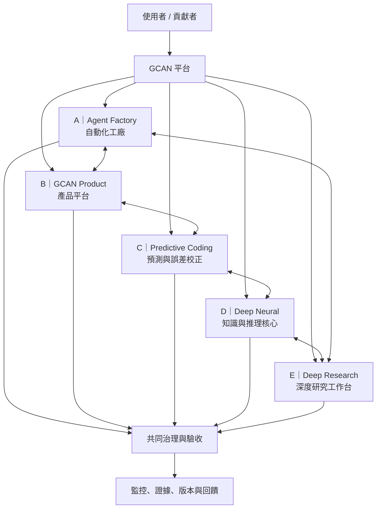

<!--
GCAN project homepage
Keep every capability label aligned with shipped code. Demo and planned features must remain clearly identified.
-->

<div align="center">

# 🌐 Global Citizen AI Network
### 全球公民 AI 網路

**讓 AI 能力、人的專業知識與可信任的協作，形成一個透明、可持續的全球網路。**

[繁體中文](#繁體中文) · [English](#english)

<br/>

[](https://nextjs.org/)
[](https://react.dev/)
[](https://www.typescriptlang.org/)
[](https://supabase.com/)
[](#授權與使用)

**專案狀態：早期開發 / MVP 建置中**  
目前不是正式商用服務；各項功能是否可用，請以本文件的「功能現況」及實際部署環境為準。

</div>

---

## 繁體中文

## ✨ 我們正在建設什麼？

Global Citizen AI Network（GCAN）是一個以人為核心的 AI 協作平台。目標不是單純提供一個聊天介面，而是逐步建立一套可管理 AI 服務、保存知識、驗證貢獻、追蹤成本，並讓參與者清楚理解資料與資源如何被使用的基礎設施。

GCAN 的核心方向：

- **人人可用的 AI 工具**：研究、寫作、分析與文件工作流程。
- **可驗證的人類貢獻**：知識整理、翻譯、評估、事實查核與工具建置。
- **透明的資源與成本**：區分供應商帳單、推估推論成本、人工審查與營運支出。
- **自願參與的運算網路**：未來才評估 CPU/GPU 資源共享；必須明確授權、可隨時退出並經過安全審查。
- **可追溯的治理制度**：任務、審查、申訴、貢獻紀錄與獎勵規則都應留下可稽核紀錄。

## 🧭 四大核心支柱

| 支柱 | 方向 | 設計重點 |
|---|---|---|
| AI 服務中心 | 研究、寫作、分析、文件與專案工作區 | 使用者資料隔離、用量限制、可保存的工作脈絡 |
| 全球貢獻中心 | 任務發布、提交、審查與申訴 | 驗收標準明確、人工覆核、貢獻紀錄可追溯 |
| 分散式運算網路 | 自願提供閒置 CPU/GPU 資源 | 延後至安全模型完成；不得暗中使用裝置資源 |
| 貢獻獎勵與治理 | 貢獻帳本、獎勵規則與治理流程 | 不承諾投資報酬；獎勵須有驗證與實際可分配來源 |

## 🏗️ 五線並行研發架構

GCAN 採用五條研發線並行推進。各線有自己的工作範圍、驗收標準與測試責任；共享成果必須經過接收方檢查，不因單一線路受阻而停止其他工作。



| 研發線 | 主要責任 | 目標工作台 |
|---|---|---|
| **A — Agent Factory V2** | 任務派送、執行、測試、復原與交付 | 工廠控制台 |
| **B — GCAN Product** | 公開入口、會員體驗、工作區與貢獻流程 | 產品平台 |
| **C — Predictive Coding** | 預測、觀測、誤差計算、校準與漂移分析 | 預測工作台 |
| **D — Deep Neural** | 知識記憶、證據來源、推理與跨線學習提案 | 知識推理工作台 |
| **E — Deep Research** | 研究任務、來源查核、反證與報告整理 | 深度研究工作台 |

**共同閉環：** 觀察 → 預測 → 行動 → 量測 → 計算預測誤差 → 保存證據與解釋 → 更新模型或計畫 → 測試 → 發布 → 跨線覆核 → 持續監控。

AI 的建議或預測不得自行取得正式環境的資料庫、帳號、金流、權限或部署變更權。高風險操作必須有明確授權、人工審核與可回復機制。

## 🖥️ 功能現況與產品入口

以下是程式碼中已建立或規劃的主要入口。**有頁面不代表所有外部服務已啟用**；例如 AI 供應商憑證、付款、獎勵提領與分散式運算節點，都不能只因介面存在就視為正式上線。

| 路徑 | 功能 | 現況說明 |
|---|---|---|
| `/` | 公開平台首頁 | 專案介紹與早期產品入口 |
| `/login` | 會員登入 | 公開註冊預設關閉 |
| `/workspace` | AI 工作區 | 已有對話與伺服器端 AI API 流程；供應商憑證及預算未設定時會停止 AI 呼叫 |
| `/account` | 會員帳戶 | 會員帳戶頁面 |
| `/contribute` | 貢獻中心 | 顯示資料庫已發布任務並接收會員提交 |
| `/contributions` | 個人貢獻紀錄 | 顯示提交、申訴與帳本狀態；不代表可自動提領 |
| `/admin/contribution-tasks` | 任務管理 | 管理員建立與管理貢獻任務 |
| `/admin/contributions` | 貢獻審查 | 審查提交內容與處理獎勵帳本流程 |
| `/admin/appeals` | 申訴審理 | 審查會員對退件結果提出的申訴 |
| `/admin/ai-costs` | AI 成本管理 | 分類檢視成本資料 |
| `/admin/ai-operations` | AI 營運處理 | 管理需人工核對的逾期 AI 請求 |
| `/predictive-coding` | 預測工作台 | 研發中；示範資料不代表已連接正式預測管線 |
| `/deep-neural` | Deep Neural 工作台 | 研發中；未持久化的提案不可視為正式知識紀錄 |
| `/deep-research` | Deep Research 工作台 | 研發中；示範來源不代表已完成即時檢索與查證 |

### 已建立的後端安全流程

- 會員資料讀取依使用者身分與資料列層級安全（RLS）隔離。
- 貢獻任務僅接受符合狀態與欄位規則的提交。
- 審查流程由資料庫端再次驗證審查者權限，並以交易方式更新審查結果、提交狀態、貢獻帳本、待處理獎勵帳本與稽核事件。
- 重複審查請求具備冪等性；同一冪等鍵若搭配不同內容，應拒絕處理。
- 申訴限於本人提交的退件項目，並有唯一性限制。
- AI 請求設計有冪等鍵、用量限制與逾額停止機制；供應商設定未完成時採 fail-closed。

## 🔐 安全、隱私與信任原則

1. **最小權限**：一般會員、審查者、管理員與伺服器端服務採不同權限邊界。
2. **不暗中挖礦或運算**：任何裝置資源使用都必須明確告知、取得同意並可退出。
3. **不承諾投資報酬**：不以保證收益、拉人頭或強制代幣作為參與條件。
4. **獎勵先驗證再記帳**：提交內容不等於已驗收，更不等於可提領現金。
5. **成本分項揭露**：供應商實際帳單、內部估算、人工審查、基礎設施與營運支出分開記錄。
6. **人類覆核**：AI 不應成為判斷自身正確性的唯一裁判。
7. **資料可控**：提供資料檢視、匯出與刪除申請機制，並遵守必要的法定保存義務。
8. **高風險操作需人工授權**：AI 不能自行修改正式環境權限、金流或部署設定。

## 🗺️ 開發路線圖

| 階段 | 交付方向 | 驗收重點 |
|---|---|---|
| Foundation | 架構、資料模型、身分驗證、安全基線 | 權限邊界、RLS、測試與成本停止機制 |
| MVP | AI 工作區、專案、貢獻任務、提交審查與帳本 | 核心流程可測試、錯誤可追蹤、資料隔離 |
| Workbench | 五線工作台與跨線協作 | 每條線有真實操作、持久化邊界與驗收測試 |
| Expansion | 多語言、更多 AI 工具與社群協作 | 成本透明、品質評估與治理機制 |
| Distributed Compute | 自願式 CPU/GPU 參與 | 獨立安全審查、明確授權、隔離與退出機制 |

**目前不在 MVP 承諾範圍內：** 大型基礎模型自訓、公開代幣、保證收益、無審核自動發獎、未經審查的全球運算節點網路。

## 🚀 本機開發

需求：Node.js 22.13+、npm。

```bash
npm ci
cp .env.example .env.local
npm run dev
```

開啟 [http://localhost:3000](http://localhost:3000)。

常用檢查：

```bash
npm run lint
npm run test:unit
npm run build
```

資料庫遷移、Supabase 本機環境與 RLS 測試，請依照下方文件執行。請勿將服務金鑰、環境變數或使用者資料提交到 Git。

## 📚 技術文件

| 文件 | 說明 |
|---|---|
| [產品範圍與階段路線圖](docs/product-scope.md) | 產品目標、MVP 邊界與分階段規劃 |
| [系統架構](docs/architecture.md) | 應用程式與服務架構 |
| [安全與隱私基線](docs/security-baseline.md) | 權限、資料保護與安全原則 |
| [資料模型與成本帳本](docs/data-model.md) | 核心資料與成本分類 |
| [資料庫安全與上線檢查](docs/database-safety.md) | 資料保存、安全與上線前驗證 |
| [資料庫遷移](docs/database.md) | Schema 與遷移流程 |
| [後端建置清單](docs/backend-setup.md) | 後端環境設定 |
| [RLS 測試計畫](docs/rls-test-plan.md) | 資料列層級安全測試 |
| [身分驗證實作](docs/authentication.md) | 登入與會員驗證 |
| [API 參考](docs/api.md) | 應用程式 API |
| [AI 預算超額硬停止](docs/ai-budget-overrun-hard-stop.md) | AI 預算保護與停止條件 |

## 🤝 貢獻方式

早期貢獻任務必須明確列出工作範圍、驗收條件、負責人、授權或著作權條款，以及是否屬於有償、志願或符合獎勵資格的工作。志願參與完全自願，不得被當作長期取代有薪工作的方式。

## 授權與使用

本專案目前尚未選定開源授權。正式授權文件加入前，所有權利均由專案權利人保留；請勿自行假設可自由再散布或商業使用。

---

## English

Global Citizen AI Network (GCAN) is a people-centered AI collaboration platform. It aims to combine useful AI workflows, verifiable human contributions, transparent cost accounting, and accountable governance.

### Four pillars

1. **AI Service Center** — research, writing, analysis, and project workflows.
2. **Global Contribution Center** — scoped tasks, submissions, human review, appeals, and auditable records.
3. **Distributed Compute Network** — a future opt-in capability, deferred until independent security review.
4. **Contribution Rewards & Governance** — transparent contribution records and rules; no guaranteed returns.

### Five parallel workstreams

- **A — Agent Factory V2:** task dispatch, execution, testing, recovery, and delivery.
- **B — GCAN Product:** public entry, member experience, workspace, and contribution workflows.
- **C — Predictive Coding:** predictions, observations, error calculation, calibration, and drift analysis.
- **D — Deep Neural:** knowledge provenance, evidence, reasoning, and reviewed learning proposals.
- **E — Deep Research:** research tasks, source verification, counter-evidence, and reports.

The workstreams follow a shared observe → predict → act → measure → explain → improve → test → review → monitor loop. Cross-workstream changes require receiving-owner review and compatibility checks. AI recommendations must not autonomously change production permissions, billing, databases, or deployments.

### Current status

GCAN is in early development and is **not production-ready**. Some application routes and backend workflows exist, while external AI-provider activation, payment processing, reward payouts, and distributed compute are not enabled merely by the presence of UI or code. Demo records must not be interpreted as live data or paid work.

### Development

Requirements: Node.js 22.13+ and npm.

```bash
npm ci
cp .env.example .env.local
npm run dev
```

Run checks with `npm run lint`, `npm run test:unit`, and `npm run build`. See the documentation links above for database setup, migrations, security, and API details.

### Trust principles

- No silent use of participant device resources.
- No guaranteed investment returns, mandatory speculative tokens, or pyramid/referral schemes.
- Rewards require verified work and published rules.
- Human review remains available.
- Provider charges, internal estimates, review costs, infrastructure, and operating expenses are accounted for separately.
- Personal data is subject to access, export, and deletion-request processes, with legally required retention respected.

---

<div align="center">

**Build useful AI. Value human work. Make the system auditable.**

<sub>Global Citizen AI Network · README maintained with the project source of truth</sub>

</div>


## CI 工程紀錄

- **2026-11-20：** Windows Runner 的 Supabase CI 連接埠配置改用 `20000–39999`，避開 Windows 預設動態 TCP 連接埠範圍；並新增回歸測試，防止舊範圍再次引入。此修正仍須以最新 PR head 的完整 CI（含 PostgreSQL/RLS）驗證後才能驗收。
